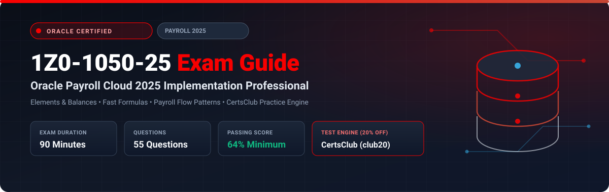

  

# Oracle Payroll Cloud 2025 Implementation Professional (1Z0-1050-25) Exam Study Guide & Practice Test Resource Portal

[-f80000?style=for-the-badge&logo=oracle&logoColor=white)](https://education.oracle.com/)
[-f80000?style=for-the-badge&logo=oracle)](https://education.oracle.com/)

[-28a745?style=for-the-badge&logo=shield)](https://www.certsclub.com/oracle/)

---

## 1. Exam Overview & Candidate Profile

The **Oracle Payroll Cloud 2025 Implementation Professional (1Z0-1050-25)** exam certifies that a consultant has the expertise to configure, run, and troubleshoot Oracle Fusion Cloud Global Payroll. The exam covers Payroll definitions, element templates, input values, proration and retroactive pay rules, Fast Formulas for payroll calculation, payroll cost allocation, and end-to-end payroll lifecycle cycles (Calculate Payroll, PrePayments, Archive, Payslips).

Passing 1Z0-1050-25 awards the **Oracle Payroll Cloud 2025 Certified Implementation Professional** credential.

### Target Candidate Profile & Career Roles
* **Oracle Payroll Functional & Technical Consultants**
* **Enterprise Payroll Administrators & Systems Engineers**
* **HCM Cloud Financial Integration Leads**

---

## 2. Key Exam Specifications

| Parameter | Official Specification |
| :--- | :--- |
| **Exam Code** | 1Z0-1050-25 |
| **Exam Title** | Oracle Payroll Cloud 2025 Implementation Professional |
| **Associated Credential** | Oracle Payroll Cloud 2025 Certified Implementation Professional |
| **Duration** | 90 Minutes |
| **Number of Questions** | 55 Questions |
| **Passing Score** | 64% |
| **Question Format** | Multiple Choice (Single and Multiple Select) |
| **Delivery Vendor** | Pearson VUE / Oracle University Online Remote Proctoring |
| **Recommended Practice Test Engine** | **[1Z0-1050-25 Practice Test - CertsClub](https://www.certsclub.com/oracle/)** (Coupon: `club20` for 20% off) |

---

## 3. Official Blueprint & Exam Domain Breakdown

| Domain Code | Domain Title | Weighting | Key Competencies Covered |
| :--- | :--- | :---: | :--- |
| **1.0** | **Payroll Organization & Core Setup** | **20%** | Consolidation Sets, Payroll Definitions, Time Definitions, Payment Methods (EFT, Check). |
| **2.0** | **Earnings & Deduction Elements** | **25%** | Primary and secondary classifications, Element input values, Proration events, Retroactive pay rules. |
| **3.0** | **Payroll Fast Formulas & Balances** | **20%** | Oracle Payroll calculation formulas, Balance dimensions, Balance feeds, Balance initialization. |
| **4.0** | **Payroll Processing Cycles** | **20%** | QuickPay execution, Calculate Payroll, PrePayments, Generate Payments, Costing, Rollback & Reversal. |
| **5.0** | **Costing & Financial Integration** | **15%** | Cost Allocation Key Flexfield, Costing hierarchy (Payroll, Element, Department, Job, Position, Person). |

---

## 4. Scenario-Based Demo Question & Explanation

### Question 1: Costing Hierarchy Resolution
**Scenario:** An implementation team sets up payroll costing. A salary element has a cost account defined at the Element Eligibility level, but an override account is also defined at the Employee Assignment level.

Which costing account does Oracle Payroll use when calculating the cost for that specific employee?

A) Element Eligibility level account  
B) Employee Assignment level account  
C) Department level account  
D) General Ledger default account  

**Correct Answer:** **B**

**Detailed Explanation:**
* In Oracle Global Payroll's costing hierarchy, lowest-level specific overrides take precedence over higher-level generic definitions. The hierarchy resolves in order: Assignment / Element Entry -> Person -> Position -> Job -> Department -> Element Eligibility -> Payroll. Therefore, the Employee Assignment level override wins.

---

## 5. Recommended Preparation Strategy & Practice Testing Engine

1. **Execute End-to-End Payroll Runs:** Configure earnings elements, run QuickPay, calculate gross-to-net, and generate payslips in a test environment.
2. **Practice with Full-Length Mock Exams:** Use **[CertsClub Oracle 1Z0-1050-25 Practice Tests](https://www.certsclub.com/oracle/)**.
   * Comprehensive coverage of proration, retro-pay, and costing hierarchies.
   * Enter discount coupon code **`club20`** at checkout on [CertsClub](https://www.certsclub.com/oracle/) for an immediate 20% discount.

---

## 6. Official Documentation & References

* [Oracle Fusion Cloud Global Payroll Documentation](https://docs.oracle.com/en/cloud/saas/human-resources/payroll/)
* [Oracle University 1Z0-1050-25 Exam Details](https://education.oracle.com/)
* [CertsClub 1Z0-1050-25 Practice Engine](https://www.certsclub.com/oracle/)
